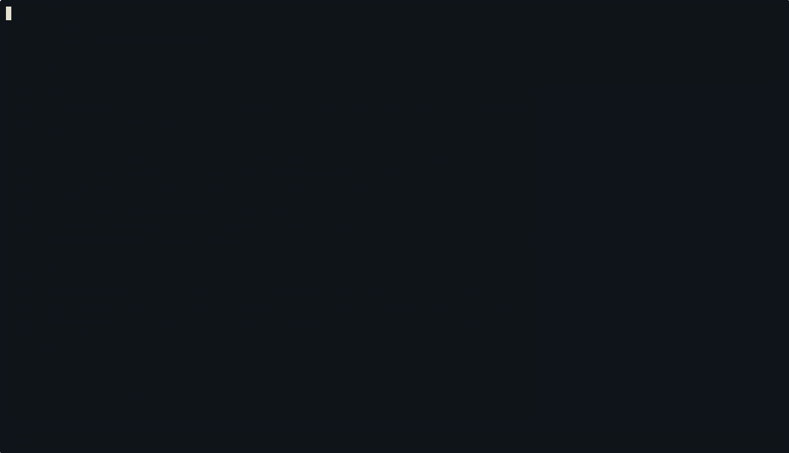

# Snippets

[![Tests][tests-badge]][tests-workflow]
[![Lean][lean-badge]](https://lean-lang.org/)
[![Nix][nix-badge]](https://nixos.org/)
[![License: MIT][mit-badge]](https://opensource.org/licenses/MIT)

A Language Server Protocol (LSP) implementation for code snippet completion, written in Lean 4 and designed to integrate with the Helix editor and other LSP-compatible editors.

[](https://asciinema.org/a/3n6Jo2vDJN7YHpAt)

## Features

- **LSP-Compliant** - Full support for the Language Server Protocol
- **Simple Configuration** - Plain `key=value` snippet definitions
- **Helix Integration** - Optimized for the Helix editor
- **Debug Logging** - Built-in debugging via `SNIPPETS_DEBUG`

## Development environment

The toolchain is pinned in `lean-toolchain` (`leanprover/lean4:v4.35.0`) and provided through Nix + elan:

```bash
nix develop   # drops into a shell with lean/lake at the pinned version
lake build snippets snippets-tests
.lake/build/bin/snippets-tests
```

Note: Nix flakes only see tracked or staged files — run `git add` on new files once if `nix develop` reports that it cannot find the flake.

## Production install

```bash
nix develop -c lake build snippets snippets-tests
.lake/build/bin/snippets-tests
install -m 755 .lake/build/bin/snippets ~/.local/bin/snippets
strip ~/.local/bin/snippets   # optional, 110 MB -> 76 MB
cp snippets.toml ~/.config/helix/snippets.toml
```

The binary is statically linked against the Lean libraries, so the installed copy runs without the Lean toolchain or `LEAN_PATH` set.

## Running

```bash
snippets
```

The server reads snippets from `~/.config/helix/snippets.toml` (falling back to `./snippets.toml`) and speaks LSP over stdin/stdout. Set `SNIPPETS_DEBUG=1` for debug logging on stderr.

Example snippets file:

```toml
:eq=≡
:neq=≢
:and=∧
:or=∨
:implies=⇒
:follows=⇐
```

The completions are triggered by the characters `:`, `^`, and `_`. The full example file in this repository is [snippets.toml](snippets.toml).

Example Helix configuration (`~/.config/helix/languages.toml`):

```toml
[language-server.snippets]
command = "/home/lamg/.local/bin/snippets"

[[language]]
name = "markdown"
language-servers = ["snippets"]

[[language]]
name = "lean"
language-servers = ["lean", "snippets"]
```

## Layout

- `SnippetsLean/Types.lean` — `Config` and `Snippet`
- `SnippetsLean/TomlParser.lean` — the simple `key=value` snippets parser
- `SnippetsLean/Config.lean` — config/snippet loading and `SNIPPETS_DEBUG`
- `SnippetsLean/Protocol.lean` — server state, completion, message dispatch
- `Main.lean` — the stdin/stdout server loop
- `Tests/Main.lean` — parser, protocol, and framing tests

## License

MIT License

[tests-badge]: https://github.com/lamg/snippets/actions/workflows/test.yml/badge.svg
[tests-workflow]: https://github.com/lamg/snippets/actions/workflows/test.yml
[lean-badge]: https://img.shields.io/badge/Lean-4.35.0-blue?style=flat-square
[nix-badge]: https://img.shields.io/badge/Nix-flake-5277C3?style=flat-square&logo=nixos&logoColor=white
[mit-badge]: https://img.shields.io/badge/License-MIT-yellow?style=flat-square
